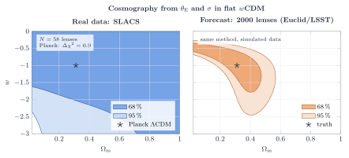
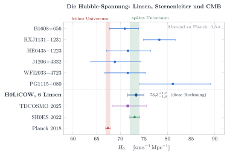
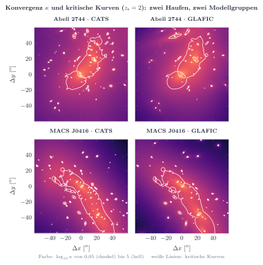
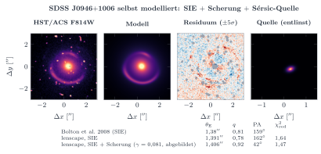

# lenscape

Gravitationslinsen modellieren, interaktiv erkunden und mit echten Beobachtungsdaten auswerten.

Die Idee: Mit derselben Physik, die einen Einsteinring im Simulator erzeugt, sollen sich echte Linsen
vermessen lassen. Daraus folgen Massen von Galaxien und Haufen, der Anteil Dunkler Materie und, über die
Distanzen, der Einfluss der Kosmologie (Ωₘ, Dunkle Energie w, H₀).

## Physik in einem Satz

Ein Lichtstrahl, der die Linse unter dem Winkel **θ** passiert, kommt von der Quellposition

```
β = θ − α(θ),        θ_E² = 4GM/c² · D_ds / (D_d · D_s)
```

Die Kosmologie geht nur über die Winkeldurchmesser-Distanzen D_d, D_s und D_ds ein, also über die kritische
Flächendichte Σ_crit = c²/(4πG) · D_s/(D_d D_ds).

## Inhalt

| Modul | Inhalt |
|---|---|
| `lenscape.cosmology` | wCDM-Kosmologie, Distanzen, Σ_crit, Einsteinradien, M(<θ_E), Zeitverzögerungs-Distanz |
| `lenscape.lenses` | Punktmasse, SIS, SIE (elliptisch), NFW-Halo, externe Scherung, Überlagerungen |
| `lenscape.sources` | Gauß-, Sérsic- und Bildquellen |
| `lenscape.raytrace` | Ray-Tracing mit Supersampling, Konvergenz- und Vergrößerungskarten |
| `lenscape.caustics` | kritische Kurven und Kaustiken |
| `lenscape.solver` | Bildpositionen und Vergrößerungen einer Punktquelle |
| `lenscape.catalogs` | echte Linsenkataloge einlesen (SLACS, CDS/VizieR-Format) |
| `lenscape.strong_lenses` | Einsteinmassen, σ_SIE, M/L und Anteil Dunkler Materie einer Stichprobe |
| `lenscape.timedelay` | Fermat-Potential und Zeitverzögerungen zwischen Bildern |
| `lenscape.h0licow`, `lenscape.h0_inference` | die sechs H0LiCOW-Linsen und der H₀-Posterior |
| `lenscape.clustermaps` | gitterbasierte Massenkarten (z. B. Frontier Fields) als Linse, FFT-Ablenkung, Massenprofile |
| `lenscape.imagefit` | Linsenmodell direkt an ein Bild fitten (Licht, SIE+Scherung, Quelle, PSF) |
| `lenscape.cosmography` | Ωₘ-w-Fit aus Einsteinradien und Geschwindigkeitsdispersionen |
| `analysis/` | Auswerteskripte mit Ergebnissen und Abbildungen |
| `app/` | interaktiver Simulator (Streamlit) |
| `web/` | Nebenprojekt für die Website: eigenes Foto hochladen und verbiegen |

## Installation

```bash
python -m venv .venv
source .venv/bin/activate          # Windows: .venv\Scripts\activate
pip install -e ".[app,dev]"
```

## Simulator starten

```bash
streamlit run app/streamlit_app.py
```

Regler für Kosmologie (H₀, Ωₘ, Ω_Λ, w), Rotverschiebungen, Massenmodell und Quelle. Drei Ansichten:

- **Simulator**: Quellebene mit Kaustiken neben der beobachteten Bildebene mit kritischen Kurven; die Bilder der
  Quellmitte werden mit Vergrößerung und Parität aufgelistet.
- **Konvergenz & Vergrößerung**: κ- und |μ|-Karten.
- **Dunkle Energie & Kosmologie**: Wie stark hängt die aus einem beobachteten θ_E abgeleitete Masse von w und Ωₘ ab?

## Als Bibliothek

```python
from lenscape import LensGeometry, SIE, ExternalShear, make_cosmology
from lenscape.solver import find_images

geom = LensGeometry(z_d=0.3, z_s=1.0, cosmo=make_cosmology(Om0=0.31, w0=-1.0))
lens = SIE(geom.theta_E_sis(250), q=0.7) + ExternalShear(0.05, 0.0)

print(geom.mass_in_theta_E(geom.theta_E_sis(250)))   # M_sun innerhalb θ_E
print(find_images(lens, 0.05, 0.03))                 # 4 Bilder: x, y, μ
```

## Echte Daten: 63 SLACS-Linsen

```bash
python scripts/fetch_cds.py     # nur nötig, falls data/ fehlt
python analysis/slacs.py        # rechnen; Datentabellen nach figures/slacs/data/, Ergebnisse nach analysis/slacs_results.md
python figures/build.py         # TikZ/pgfplots-Abbildungen bauen (PDF + SVG, braucht LaTeX mit pgfplots)
```

Die Abbildungen sind reines TikZ/pgfplots (`figures/slacs/*.tex`, gemeinsamer Stil in
`figures/lenscape-style.tex`). Die PDFs lassen sich direkt in LaTeX-Dokumente einbinden, die SVGs in README und
Website. Python liefert nur die Daten, das Aussehen steckt komplett im TeX.



Was dabei herauskommt (Details in [`analysis/slacs_results.md`](analysis/slacs_results.md)):

- **Validierung:** Die berechneten Einsteinmassen reproduzieren die publizierten Werte von Auger et al. (2009)
  auf 0,004 dex (< 1 %).
- **Isotherme Galaxien:** Sterngeschwindigkeiten und Linsenmasse passen zusammen,
  ⟨σ_SDSS/σ_SIE⟩ ≈ 0,95 bei rund 10 % Streuung.
- **Dunkle Materie:** Innerhalb des Einsteinradius (≈ 4 kpc) besteht etwa die Hälfte der Masse aus Dunkler
  Materie (Chabrier-IMF). Mit der schwereren Salpeter-IMF wird sie bei einigen Galaxien negativ, die IMF ist dort
  also zu schwer.
- **Kosmologie:** Die Kosmographie aus 58 Linsen ist mit Planck-ΛCDM verträglich, schränkt w aber kaum ein.
  Die Prognose zeigt, dass mit der Methode erst bei Tausenden Linsen (Euclid, LSST) brauchbare Grenzen entstehen.

Im Simulator lässt sich jede SLACS-Linse auswählen („Echte Linse (SLACS)“). Ihr Einsteinradius ist beobachtet,
die Kosmologie-Regler ändern daher die abgeleitete Masse und den Dunkle-Materie-Anteil.

## H₀ aus Zeitverzögerungen (H0LiCOW)

```bash
python scripts/fetch_h0licow.py   # einmalig, öffentliche Distanz-Posteriors (~120 MB, nicht versioniert)
python analysis/h0licow.py        # Ergebnisse nach analysis/h0licow_results.md
python figures/build.py           # Abbildungen
```

Licht der Bilder eines gelinsten Quasars kommt zu unterschiedlichen Zeiten an. Aus Verzögerung und Linsenmodell
folgt die Zeitverzögerungs-Distanz D_Δt ∝ 1/H₀. Mit den öffentlichen Posteriors der sechs H0LiCOW-Linsen
reproduziert lenscape das veröffentlichte Ergebnis **H₀ = 73,3 +1,7 −1,8 km/s/Mpc** (Wong et al. 2020) und liegt
damit 3,3σ über Planck. Im Simulator zeigt die Bildtabelle die Verzögerungen in Tagen; der Reiter
„H₀ aus Zeitverzögerungen“ erlaubt, einzelne Linsen weg- oder hinzuzunehmen.



## Galaxienhaufen: Hubble Frontier Fields

```bash
python scripts/fetch_frontier.py   # Massenkarten von MAST (Abell 2744, MACS J0416; Teams CATS, GLAFIC)
python analysis/frontier.py        # Massenprofile, Einsteinradien, Suchfläche für Galaxien bei z = 9
```

Jede Karte wird zu einer Linse wie die analytischen Modelle. Verglichen werden die Modellgruppen untereinander;
zur Kontrolle rechnet lenscape die Ablenkwinkel per FFT aus κ nach. Ergebnis (Details in
[`analysis/frontier_results.md`](analysis/frontier_results.md)): CATS und GLAFIC liefern für beide Haufen nahezu
denselben effektiven Einsteinradius (Abell 2744: 21,4″ / 21,8″, MACS J0416: 24,7″ / 25,1″ für z_s = 2) und
innerhalb von 100 kpc dieselbe Masse auf 1–3 %.



## Ein echtes HST-Bild modellieren

```bash
pip install -e ".[data]"
python scripts/fetch_hst_slacs.py J0946+1006   # Ausschnitt aus dem HST-Archiv
python analysis/slacs_hst_fit.py J0946+1006    # Fit und Vergleich mit Bolton et al. (2008)
```

Vorwärtsmodell aus Linsenlicht, SIE + Scherung, gelinster Quelle und PSF, in drei Stufen gefittet; kosmische
Strahlung wird maskiert. Am echten HST-Bild von J0946+1006 ergibt das reine SIE θ_E = 1,391″, q = 0,78,
PA = 162°, nahe an Bolton et al. (2008: 1,38″, 0,81, 159°). An
synthetischen Bildern findet der Fit θ_E auf besser als 0,1 % wieder; die Linsenmodelle stimmen mit
*lenstronomy* auf 10⁻¹⁰ überein (`pip install -e ".[validate]"`, dann `pytest`).



### Pixelierte Quellen und zweite Quellebene (J0946+1006, „Jackpot“)

```bash
python analysis/jackpot.py   # ~3 min; Ergebnisse in analysis/jackpot_results.md
```

`lenscape.pixsrc` rekonstruiert die Quelle frei auf einem Pixelgitter (Bayes'sche semi-lineare Inversion nach
Suyu et al. 2006); die Regularisierungsstärke und die Linsenparameter folgen aus der Bayes-Evidenz. Für den
inneren Ring sinkt χ²_red damit von 1,42 (glatte Sérsic-Quelle) auf 1,16.

Der schwache äußere Ring gehört zu einer zweiten Quelle bei z = 2,035. Das Verhältnis
η = (D_ds2/D_s2)/(D_ds1/D_s1) hängt nur von Ωₘ und w ab. Die Evidenz zeigt zwei Lösungen; die plausible
(η = 1,46 bei isothermem Profil) reproduziert Gavazzi et al. (2008). Mit etwas Masse in Quelle 1 sinkt sie auf
≈ 1,40, nahe an Collett & Auger (2014: 1,404 ± 0,016) und ΛCDM (1,388). Für eine echte Kosmologie-Aussage
fehlen tiefere Daten und eine Einschränkung der Profilsteigung – die Abbildung zeigt, warum.


## Web: Foto-Linse

`web/index.html` ist eine einzelne Datei ohne Abhängigkeiten. Im Browser öffnen, Bild hochladen (oder per
Drag & Drop), Linse mit der Maus verschieben. Gerechnet wird pro Pixel auf der Grafikkarte (WebGL2-Shader,
mit CPU-Rückfall); als Linse stehen Punktmasse bzw. Schwarzes Loch und eine elliptische Galaxie (SIE) zur Wahl.
Für die eigene Website lässt sich die Seite per `<iframe src="…/index.html?embed">` ohne Kopfzeile einbetten. Die Regler steuern Masse, Abstände, Bildbreite und die
**Lichtgeschwindigkeit** (θ_E ∝ 1/c). Szenarien: Galaxie, Sonne wie bei Eddington 1919, dieselbe Sonne bei
1 % von c, ein murmelgroßes Schwarzes Loch im Zimmer.

## Tests

```bash
pytest
```

Die Tests prüfen unter anderem die Poisson-Gleichung ∇·α = 2κ für jedes Modell, die Rotationsfreiheit von α,
analytische Bildpositionen und Vergrößerungen der SIS und M(<θ_E) = M für eine Punktmasse.

## Fahrplan

- [x] Simulator und Kosmologie (Punktmasse, SIS, SIE, NFW, Scherung, Kaustiken, Bildlöser)
- [x] Web-Demo „eigenes Bild verbiegen“
- [x] **Starke Linsen aus echten Daten**: SLACS-Katalog, Massen, Dunkle-Materie-Anteil, Kosmographie
- [x] **Galaxienhaufen**: Frontier-Fields-Massenkarten einlesen und vergleichen (Daten per Skript)
- [x] **Zeitverzögerungen**: Fermat-Potential, H₀ aus den sechs H0LiCOW-Linsen
- [x] **Modell-Fit**: SIE+Scherung direkt an HST-Bilder, Abgleich mit `lenstronomy`
- [x] **Web-Demo** mit WebGL2 und Einbettungsmodus
- [x] **Pixelierte Quellen** (Suyu et al. 2006) und **zweite Quellebene** des Jackpot-Systems
- [ ] Elliptisches Potenzgesetz-Profil (freie Steigung γ′) für die Jackpot-Kosmologie
- [ ] **Schwache Linsen**: Scherungskataloge bzw. Planck-CMB-Lensing-Karte, Ωₘ und σ₈
