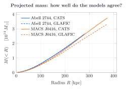
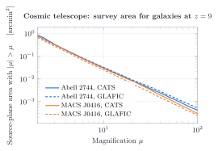

# Hubble Frontier Fields: Massenmodelle im Vergleich

Automatisch erzeugt von `analysis/frontier.py`. Kosmologie: H₀ = 70, Ωₘ = 0,3 (wie die HFF-Modelle).

| Haufen | Team | θ_E,eff (z_s = 2) | M(<100 kpc) | M(<R_max) | A(μ>10), z_s = 9 | Ablenkkarte vs. FFT(κ) | Pixel |
|---|---|---|---|---|---|---|---|
| Abell 2744 | CATS | 21.4″ | 6.02e+13 M☉ | 2.66e+14 M☉ (R = 281 kpc) | 0.030 arcmin² (r < 62″) | 13.2 % | 0.300″ |
| Abell 2744 | GLAFIC | 21.8″ | 6.02e+13 M☉ | 2.62e+14 M☉ (R = 281 kpc) | 0.032 arcmin² (r < 62″) | 13.1 % | 0.030″ |
| MACS J0416.1−2403 | CATS | 24.7″ | 5.39e+13 M☉ | 3.75e+14 M☉ (R = 375 kpc) | 0.029 arcmin² (r < 70″) | 3.5 % | 0.300″ |
| MACS J0416.1−2403 | GLAFIC | 25.1″ | 5.24e+13 M☉ | 3.34e+14 M☉ (R = 375 kpc) | 0.024 arcmin² (r < 70″) | 16.5 % | 0.030″ |

Beide Teams werden um dasselbe Himmelszentrum ausgewertet (Mittel der zentralen κ-Maxima) und nur im Kreis, den alle Karten vollständig abdecken (die GLAFIC-Karten sind deutlich kleiner als die von CATS).

Die Spalte „Ablenkkarte vs. FFT(κ)“ ist die mediane relative Abweichung der vom Team gelieferten Ablenkwinkel von unserer FFT-Rechnung aus der κ-Karte im zentralen Bereich. Die Richtungen stimmen überall überein; die Beträge der Team-Karten sind etwas größer, weil sie auch Masse außerhalb des Kartenfelds enthalten, die der FFT fehlt.

