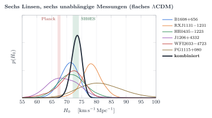
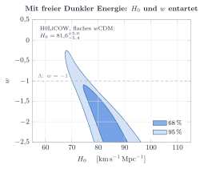

# H0 aus Zeitverzögerungen (H0LiCOW)

Automatisch erzeugt von `analysis/h0licow.py`.

| Messung | H₀ [km/s/Mpc] |
|---|---|
| B1608+656 | 71.0 −3.3 +2.9 |
| RXJ1131-1231 | 78.3 −3.4 +3.4 |
| HE0435-1223 | 71.6 −4.5 +4.8 |
| J1206+4332 | 68.9 −5.1 +5.5 |
| WFI2033-4723 | 71.6 −4.9 +3.8 |
| PG1115+080 | 81.1 −7.1 +7.9 |
| **H0LiCOW kombiniert (flaches ΛCDM, diese Rechnung)** | **73.3 −1.8 +1.7** |
| H0LiCOW kombiniert (flaches wCDM, diese Rechnung) | 81.6 −5.4 +5.0 |
| Planck 2018 (CMB, ΛCDM) | 67.4 −0.5 +0.5 |
| SH0ES (Cepheiden + SN Ia) | 73.04 −1.04 +1.04 |
| TDCOSMO 2025 | 71.6 −3.3 +3.9 |

- Veröffentlicht (Wong et al. 2020): 73,3 +1,7 −1,8 km/s/Mpc. Diese Rechnung: 73.3 +1.7 −1.8.
- Abstand zu Planck: 3.3σ, zu SH0ES: 0.2σ (Gauß-Näherung).
- TDCOSMO 2025 lockert die Annahmen über das Massenprofil (Massenblatt-Entartung, über Sternkinematik
  eingeschränkt). Die Unsicherheit wächst, der Mittelwert bleibt zwischen Planck und SH0ES.

