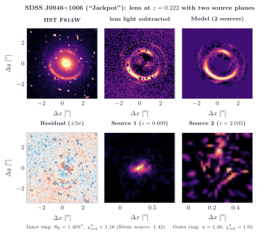
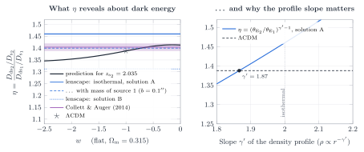

# SDSS J0946+1006: pixelierte Quellen und zweite Quellebene

Automatisch erzeugt von `analysis/jackpot.py`.

Rotverschiebungen: Linse 0.222, Quelle 1 0.609 (Bolton et al. 2008), Quelle 2 2.035 (Smith & Collett 2021).

## Innerer Ring mit pixelierter Quelle

- parametrische Sérsic-Quelle: θ_E = 1.406″, χ²_red = 1.42
- pixelierte Quelle (36×36, Gradient-Regularisierung, λ = 83.3 aus der Evidenz): θ_E = 1.405″, q = 0.963, γ_ext = 0.073, χ²_red im Ringbereich = 1.16

## Zweite Quellebene

Gescannt wurde η von 1,30 bis 1,60 (grob, dann fein um das Maximum); Ergebnis ist das Maximum der Evidenz. Das Quellgitter für Quelle 2 muss kompakt sein: Mit ±0,5″ gewinnt eine entartete Lösung bei kleinem η, in der die Quelle das kaum mehrfach abgebildete Bild abkopiert. Für jedes η wird das kompakte Gitter auf die grob rekonstruierte Quelle zentriert (mitlaufendes Gitter). Ohne Hochpass nutzt die Inversion großräumige Reste des Linsenlichts aus (schlechteres χ²); diese Variante ist nur zur Kontrolle aufgeführt und geht nicht in die Systematik ein.

| Analyse | globales Maximum η | Lösung A (η ≈ 1,46) | Lösung B (η ≈ 1,31) | ln E(A) − ln E(B) |
|---|---|---|---|---|
| Basis (Hochpass, Gitter ±0,30″) | 1.460 | 1.460 | 1.320 | +47 |
| Gitter ±0,25″ | 1.460 | 1.460 | 1.288 | +89 |
| Gitter ±0,35″ | 1.312 | 1.456 | 1.312 | -30 |
| Maske ab 1,95″ | 1.320 | 1.460 | 1.320 | -8 |
| Krümmungs-Regularisierung | 1.460 | 1.460 | 1.312 | +32 |
| ohne Hochpass (nur zur Kontrolle) | 1.308 | 1.460 | 1.308 | -23 |

- Die Evidenz ist **bimodal**: Lösung A (η ≈ 1,46) und Lösung B (η ≈ 1,31). Welche gewinnt, hängt von Analysedetails ab; die Daten (eine einzelne F814W-Aufnahme, 1048 s) trennen sie nicht sicher. Lösung B liegt am Rand des plausiblen Bereichs und entspricht einem kaum mehrfach abgebildeten äußeren Ring.
- Lösung A: θ_E2/θ_E1 = 1.460 ± 0.004 (Spannweite der Varianten) – passt zu Gavazzi et al. (2008), die aus tieferen Daten 2,07″/1,43″ = 1,45 fanden.
- Masse von Quelle 1 als SIS (Lösung A stetig verfolgt): b_s1 = 0,1″ → η = 1.400, b_s1 = 0,2″ → η = 1.340. Mehr Masse in Quelle 1 lenkt Quelle 2 zusätzlich ab; die Hauptlinse muss dann weniger leisten.
- Flaches ΛCDM (Ωₘ = 0,315) sagt η = 1.388 voraus. Isotherm und ohne Masse von Quelle 1 entspräche das gemessene η einem w ≈ -0.1; mit γ′ = 1.87 statt 2 wäre es genau ΛCDM.
- Collett & Auger (2014) marginalisieren über die Steigung γ′ und die Masse von Quelle 1 und finden η = 1,404 ± 0,016; mit der spektroskopischen Rotverschiebung z = 2,035 (Smith & Collett 2021) und einem CMB-Prior ergibt sich w = −1,04 ± 0,20.

Fazit: Der innere Ring ist mit pixelierter Quelle sehr gut bestimmt. Für den schwachen äußeren Ring reicht diese eine Aufnahme nicht für eine eindeutige Messung: Die physikalisch plausible Lösung A reproduziert den Literaturwert, eine zweite Lösung lässt sich aber nicht sicher ausschließen. Selbst mit eindeutiger Geometrie hinge die Kosmologie an der Profilsteigung γ′ und der Masse von Quelle 1 – genau den Größen, die die Forschung mit tieferen Mehrband-Daten und Sternkinematik einschränkt.

