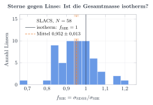
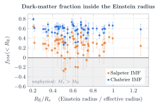
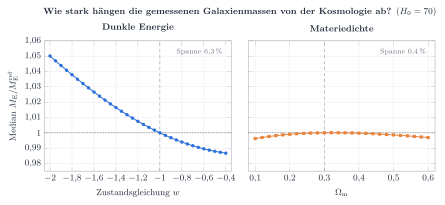

# SLACS-Auswertung

Automatisch erzeugt von `analysis/slacs.py`. Referenzkosmologie: H₀ = 70, Ωₘ = 0,3, Ω_Λ = 0,7.

## Kennzahlen

| Größe | Wert |
|---|---|
| N | 63 |
| N_good_sigma | 58 |
| median M_E [M_sun] | 1.807e+11 |
| median R_E [kpc] | 4.176 |
| mean f_SIE (gute sigma) | 0.9517 |
| std f_SIE (gute sigma) | 0.09531 |
| median M/L_V (<R_E) | 6.694 |
| median f_DM(<R_E) chab | 0.5885 |
| median f_DM(<R_E) salp | 0.2834 |

## Validierung

Unsere Einsteinmassen weichen von den publizierten Werten (Auger et al. 2009) im Mittel um +0.0006 dex ab (Streuung 0.0036 dex, 63 Linsen).

## Kosmologie

- Bestfit (flaches wCDM): Ωₘ = 0.02, w = -0.70, f_E = 1.041, intrinsische Streuung 0.15
- Planck-ΛCDM (Ωₘ = 0.3111, w = −1) liegt bei Δχ² = 0.90, also verträglich.
- Variiert man w von −2 bis −0,4, ändern sich die Mediane der Massen um 6.3 %; für Ωₘ von 0,1 bis 0,6 um 0.4 %.

## Abbildungen

Gebaut mit `python figures/build.py` (TikZ/pgfplots; PDF und SVG in `figures/slacs/`).

