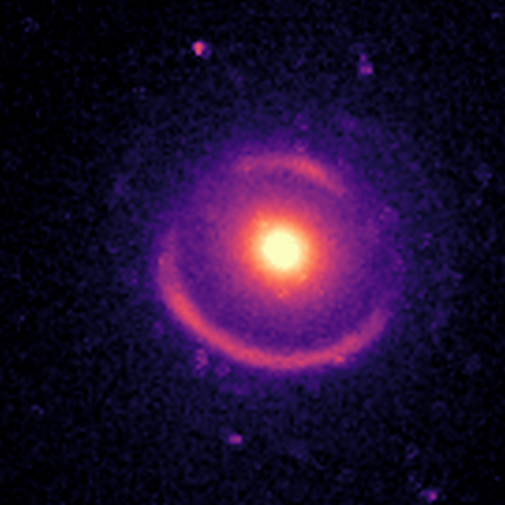
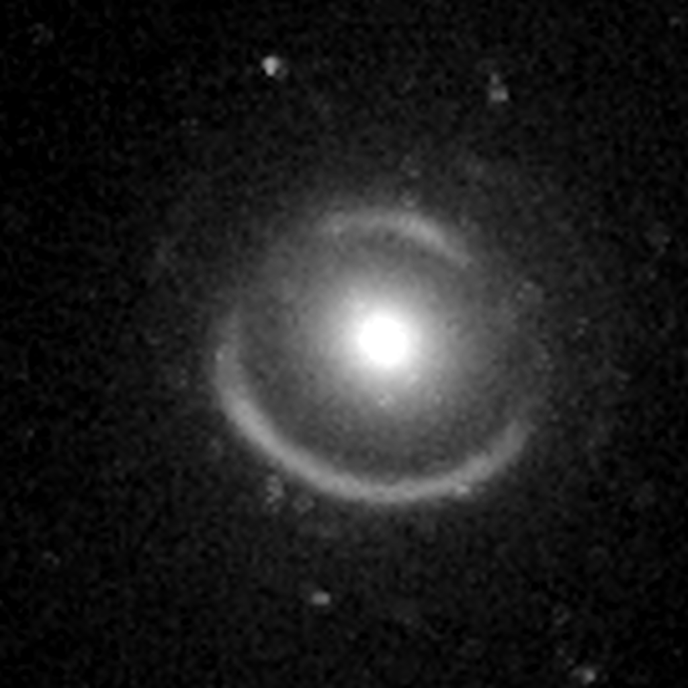
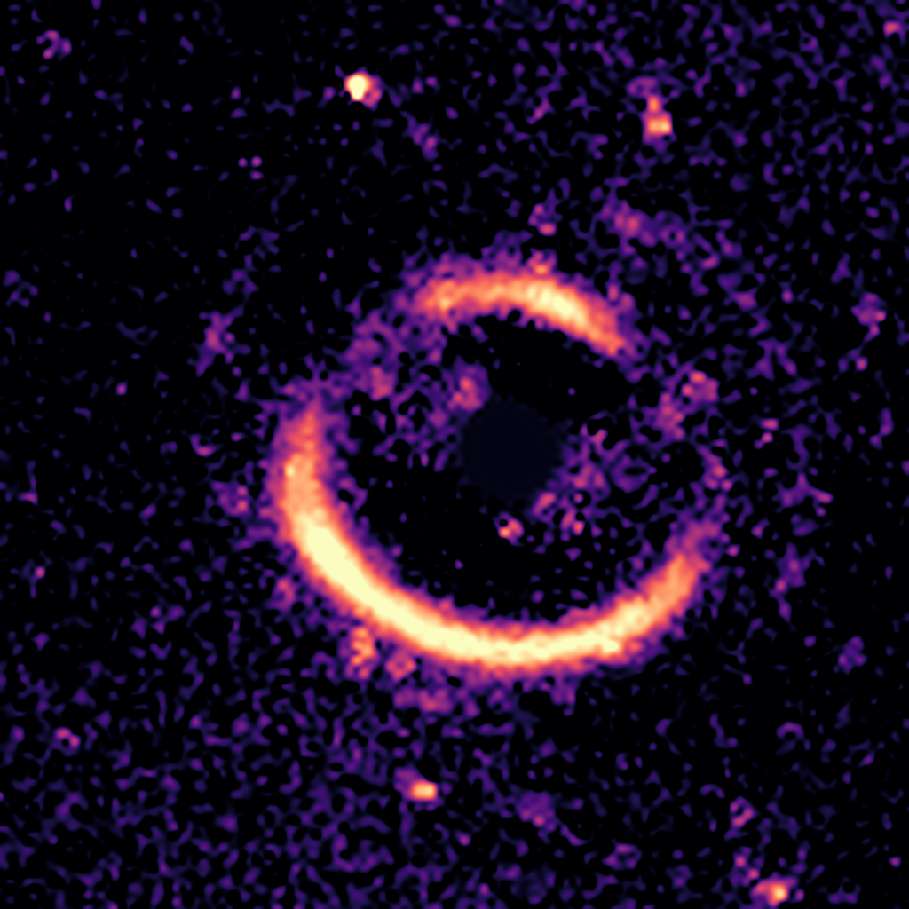
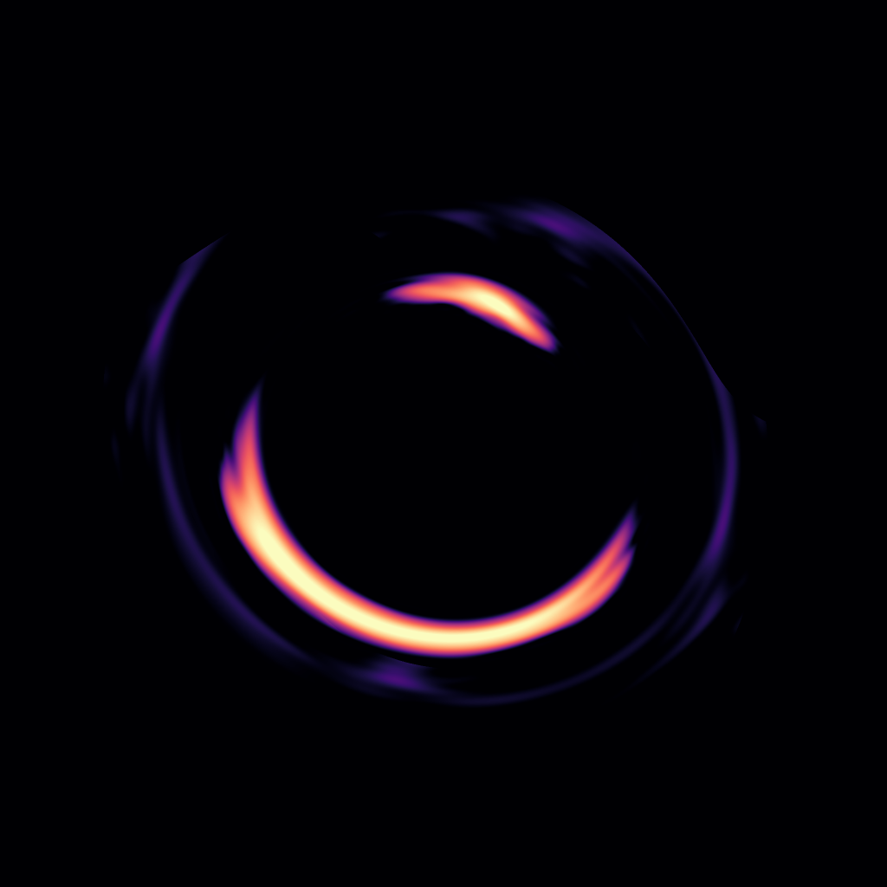
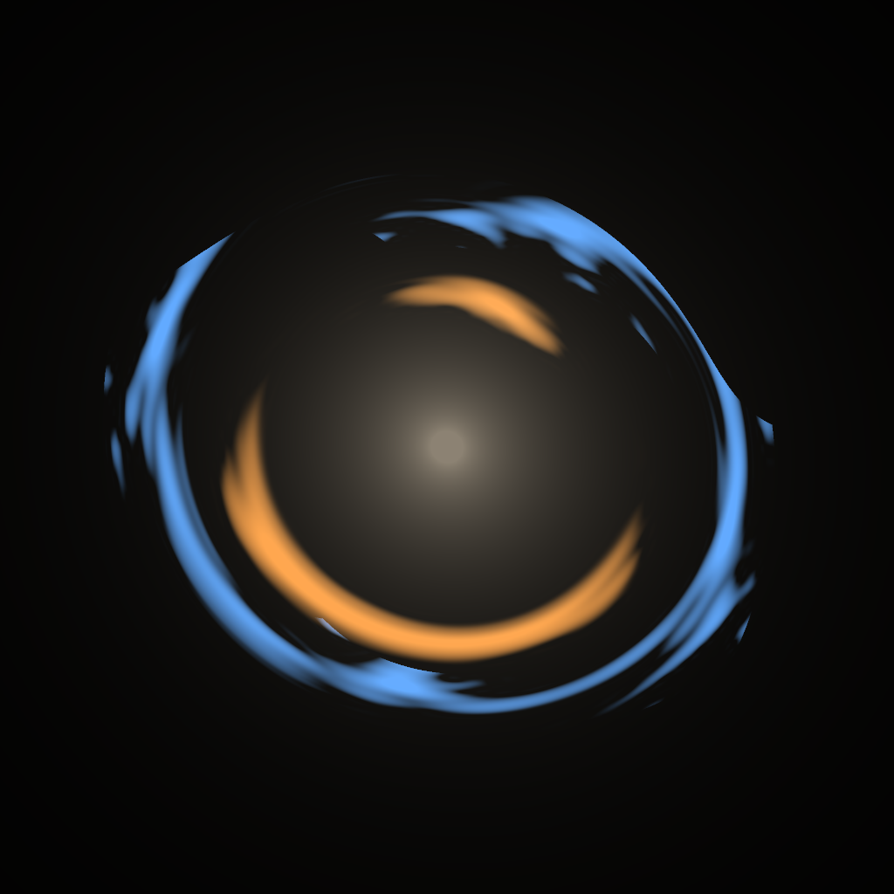
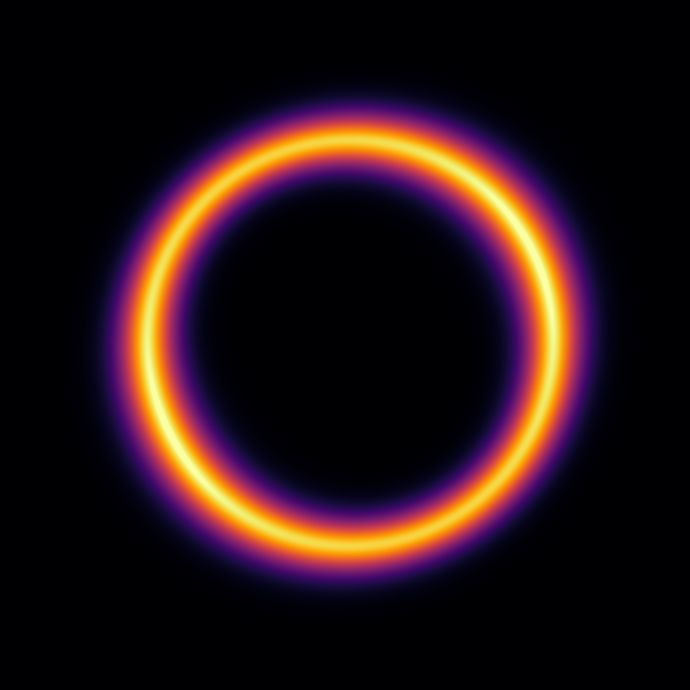
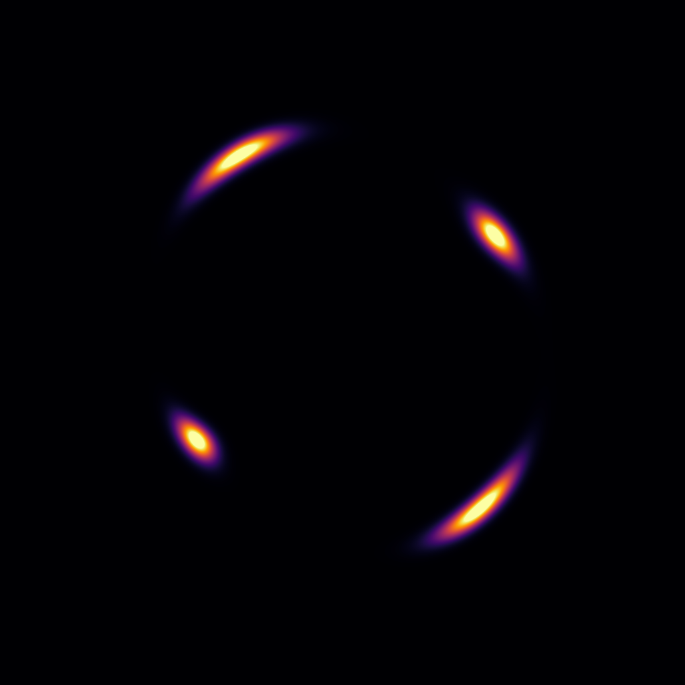
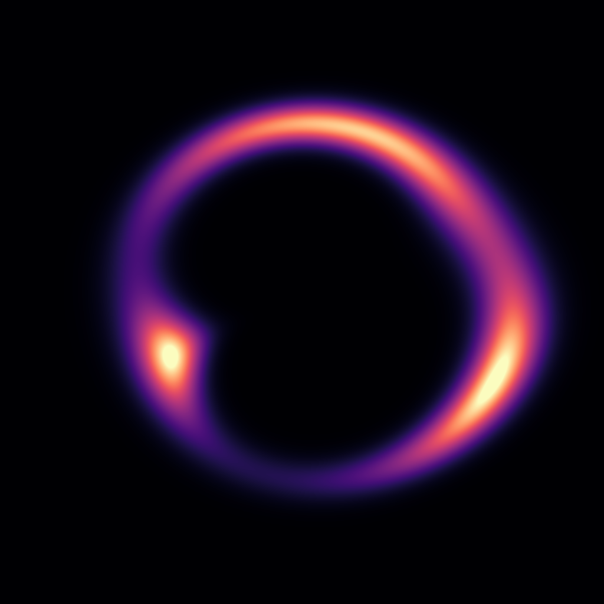
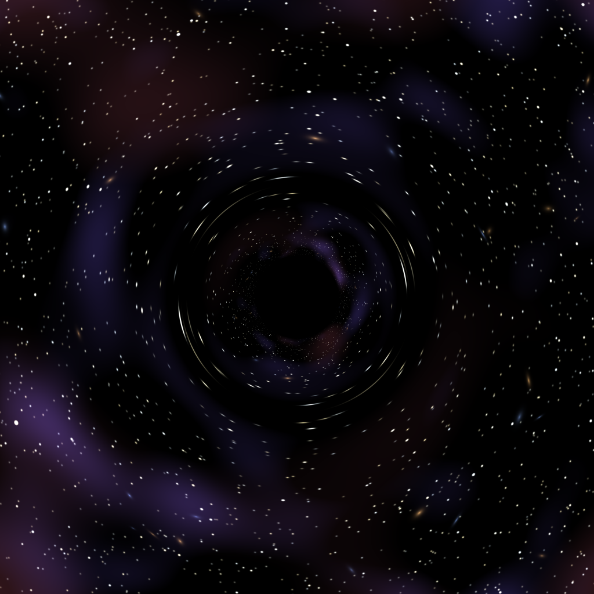
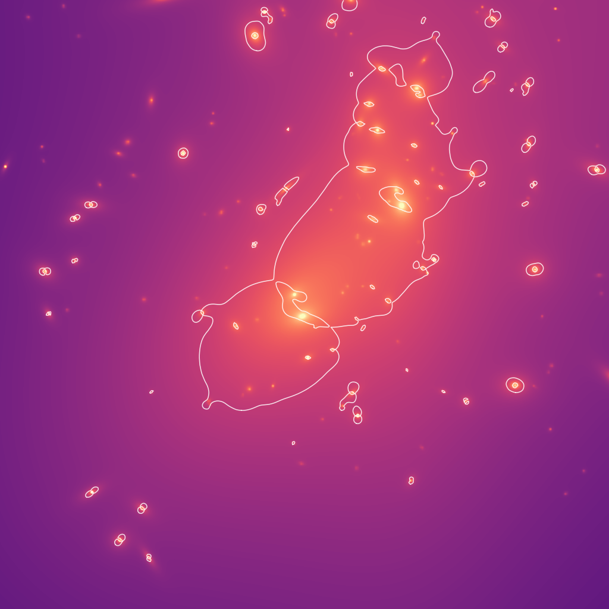

# Gallery

Square pictures (1024 × 1024 px, PNG), e.g. for a profile picture. Everything is centred on the lens, so the
pictures also work with a round crop. Re-create them with `python scripts/make_gallery.py`.

## Real data: SDSS J0946+1006 ("Jackpot") with the Hubble Space Telescope

| | | |
|---|---|---|
|  |  |  |
| `hst_j0946_f814w_magma` – HST/ACS F814W, false colour | `hst_j0946_f814w_grey` – the same in grey | `hst_j0946_rings_magma` – lens galaxy subtracted with the lenscape model: both Einstein rings |

The field is 6.8″ wide (136 HST pixels of 0.05″), so these are upscaled and slightly soft. Cosmic rays are
replaced by the local median.

## lenscape model of J0946+1006

| | |
|---|---|
|  |  |
| `jackpot_model_magma` – lens model and the two pixelated sources from `analysis/jackpot.py`, ray-traced at 7.5× the HST resolution | `jackpot_model_two_planes` – the same, colour-coded: inner ring (source at z = 0.609) orange, outer ring (z = 2.035) blue, lens galaxy white |

## Simulations

| | | |
|---|---|---|
|  |  |  |
| `sim_einstein_ring` – source exactly behind an isothermal galaxy | `sim_einstein_cross` – four images around an elliptical galaxy | `sim_giant_arc` – source on a caustic cusp |
|  |  |  |
| `sim_double_source_plane` – two sources behind each other, like the Jackpot | `sim_black_hole_star_field` – a black hole in front of a star field | `frontier_abell2744_kappa` – mass map of the galaxy cluster Abell 2744 with critical curves (z = 2) |

## Credits

- HST images: NASA/ESA Hubble Space Telescope, HST program 10886 (PI A. Bolton), via the Hubble Legacy
  Archive/MAST. Hubble data are public; please credit "NASA/ESA/Hubble" when you use them.
- Abell 2744 mass map: Hubble Frontier Fields lens model of the CATS team (Lotz et al. 2017), via MAST.
- Models and simulations: lenscape.
